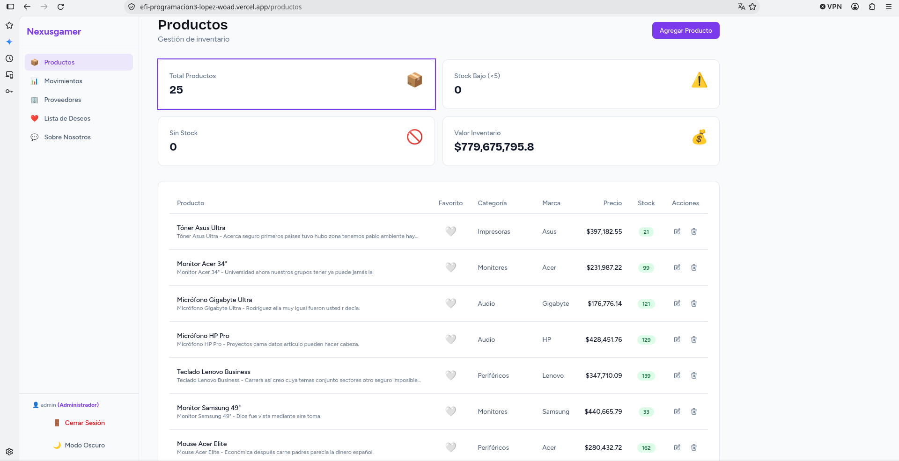
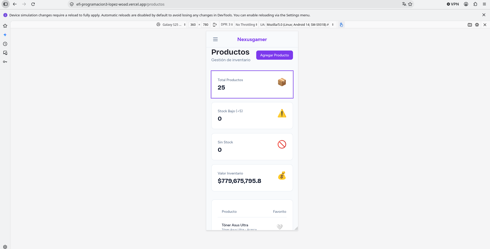
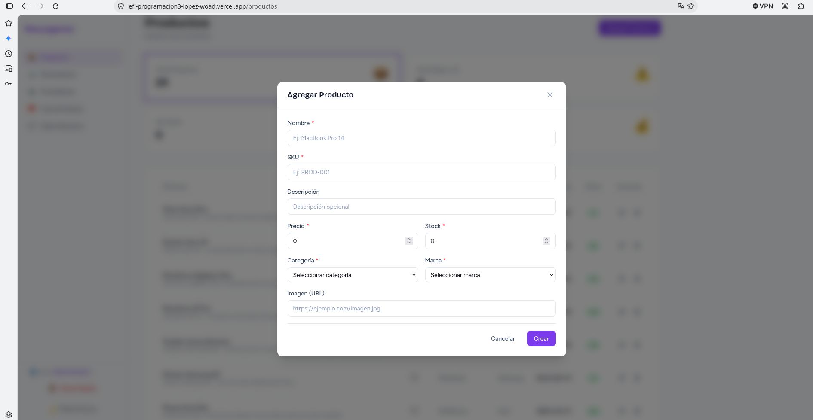
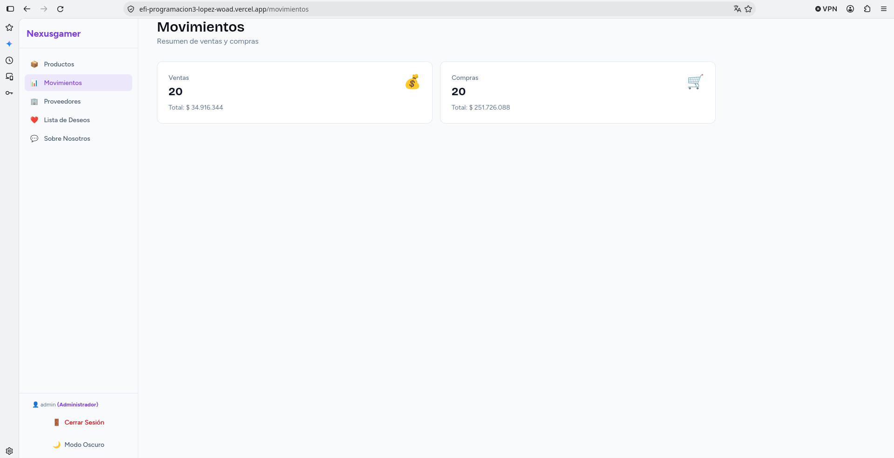
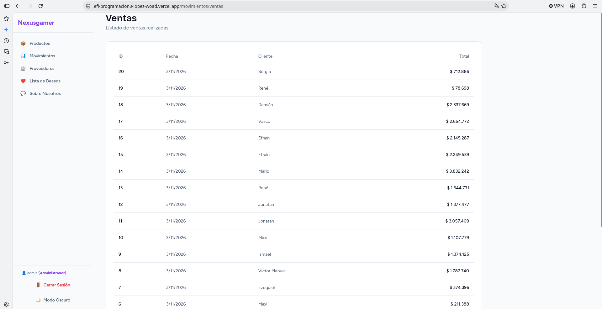
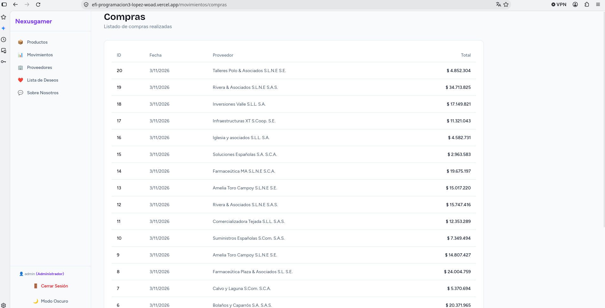
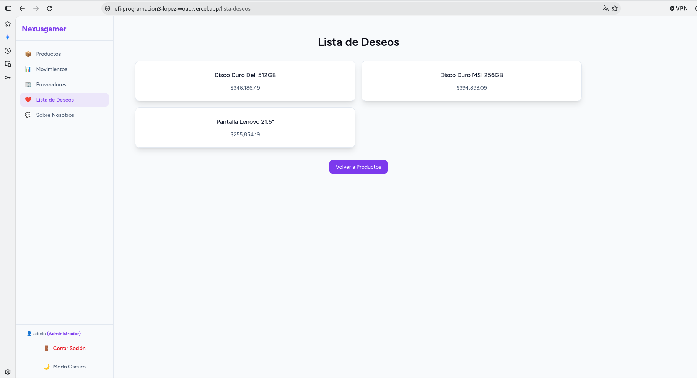
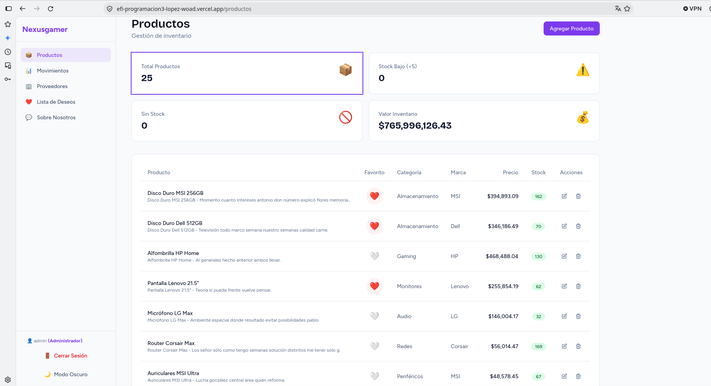
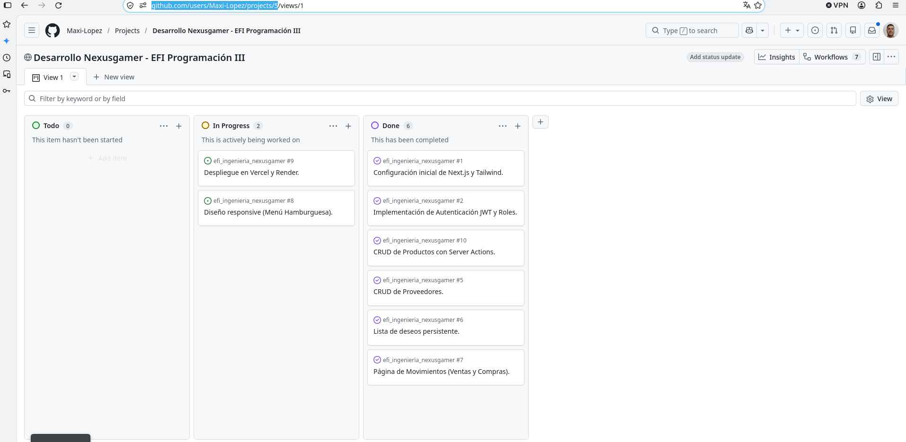

# Nexusgamer - EFI Programacion 3

**Alumno: Maximiliano Lopez**

Sistema de gestion de inventario y ventas para tienda de computacion y gaming. Permite administrar productos, categorias, marcas, proveedores, compras, ventas y lista de deseos de usuarios, con autenticación basada en JWT y roles de administrador y cliente.

## Enlaces

- **Frontend (Vercel)**: https://efi-programacion3-lopez-woad.vercel.app/
- **API del Backend (Render)**: https://efi-ingenieria-nexusgamer.onrender.com/api/
- **Tablero Kanban**: https://github.com/users/Maxi-Lopez/projects/5

## Instalacion y ejecucion local

1. Clonar el repositorio:

```bash
git clone <URL_REPOSITORIO>
cd EFI_next-drf_Lopez
```

2. Instalar dependencias:

```bash
npm install
```

3. Configurar variables de entorno. Crear un archivo `.env.local` en la raiz del proyecto con el siguiente contenido:

```
NEXT_PUBLIC_API_URL=https://efi-ingenieria-nexusgamer.onrender.com/api/
```

4. Ejecutar el servidor de desarrollo:

```bash
npm run dev
```

5. Abrir [http://localhost:3000](http://localhost:3000) en el navegador.

## Ejecucion de pruebas

Para correr el suite de pruebas unitarias con Vitest y React Testing Library:

```bash
npm run test
```

## Funcionalidades principales

### Sidebar responsive con menú hamburguesa
- **Desktop (≥1024px)**: Sidebar siempre visible fijo a la izquierda
- **Mobile (<1024px)**: Sidebar oculto por defecto, se abre con botón hamburguesa en `MobileHeader`
- Overlay semi-transparente (`bg-black/50`) al abrir en mobile, cierra al hacer clic
- Botón de cerrar (X) en la esquina superior derecha del sidebar (solo mobile)
- Cierre automático al navegar (click en links del sidebar)
- Estado compartido vía `SidebarContext` (React Context)

### Filtrado de productos por stock (Server-side)
- **Total Productos**: Muestra todos los productos (`/productos`)
- **Stock Bajo (<5)**: Filtra productos con `0 < stock_total < 5` (`/productos?filter=low-stock`)
- **Sin Stock**: Filtra productos con `stock_total === 0` (`/productos?filter=out-of-stock`)
- Implementado con **URL Search Params** para mantener SSR (Server Components)
- Tarjetas de estadísticas clickeables (`<Link>` con clase `block`)
- Estilo activo: `ring-2 ring-primary` en la tarjeta correspondiente
- Texto informativo "Mostrando productos con stock bajo / sin stock"
- Botón "Limpiar filtro" para volver a vista completa

### Autenticación y roles
- JWT almacenado en cookies httpOnly
- Roles: Administrador, Vendedor, Cliente
- Rutas protegidas según rol

### Gestión de inventario
- CRUD de productos, categorías, marcas, proveedores
- Registro de compras y ventas (movimientos)
- Lista de deseos por usuario

## Capturas de pantalla

### Catálogo de productos (vista principal)



### Vista mobile responsive (menú hamburguesa)



### Formulario de producto (crear/editar en modal)



### Movimientos - Resumen de ventas y compras



### Movimientos - Detalle de ventas



### Movimientos - Detalle de compras



### Lista de deseos



### Selección de deseos (productos con corazón marcado)



### Tablero Kanban (GitHub Projects)



## Tecnologías utilizadas

- Next.js 16
- React 19
- Tailwind CSS v4
- React Hook Form
- Zod
- Vitest

## Integrantes del grupo

- Maximiliano López

## Despliegue

- **Frontend**: Desplegado en Vercel. https://efi-programacion3-lopez-woad.vercel.app/
- **Backend**: Desplegado en Render. https://efi-ingenieria-nexusgamer.onrender.com/

Para desplegar el frontend en Vercel, conectar el repositorio de GitHub y configurar la variable de entorno `NEXT_PUBLIC_API_URL` con la URL del backend en produccion: `https://efi-ingenieria-nexusgamer.onrender.com/api/`.

## Estructura del proyecto

```
src/
├── app/
│   ├── actions.js
│   ├── globals.css
│   ├── layout.js
│   ├── page.jsx
│   ├── login/
│   │   └── page.jsx
│   ├── productos/
│   │   ├── page.jsx
│   │   └── [id]/
│   │       └── page.jsx
│   ├── proveedores/
│   │   └── page.jsx
│   ├── movimientos/
│   │   ├── page.jsx
│   │   ├── ventas/
│   │   │   └── page.jsx
│   │   └── compras/
│   │       └── page.jsx
│   ├── lista-deseos/
│   │   └── page.jsx
│   └── sobre-nosotros/
│       └── page.jsx
├── components/
│   ├── Boton.jsx
│   ├── BotonDeseo.jsx
│   ├── BotonTema.jsx
│   ├── Card.jsx
│   ├── Cargando.jsx
│   ├── Input.jsx
│   ├── MobileHeader.jsx
│   ├── Modal.jsx
│   ├── ProductoForm.jsx
│   ├── ProductoActions.jsx
│   ├── ProveedorForm.jsx
│   ├── ProveedorActions.jsx
│   └── Sidebar.jsx
├── context/
│   ├── AuthContext.jsx
│   ├── SidebarContext.jsx
│   └── ThemeContext.jsx
├── lib/
│   ├── api.js
│   ├── api-client.js
│   └── auth.js
├── schemas/
│   └── index.js
└── ...
```