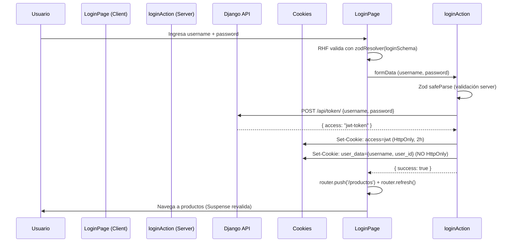

# Fase 0 + Fase 1 Completada - Nexusgamer

## 📍 Ubicación Real del Proyecto

**Los archivos fuente están en:**
```
/home/maxi/Documents/programacion3/efi2_programacion/astro/para comparar/EFI_next-drf_Lopez/
```

**Este documento está en:**
```
/home/maxi/Documents/programacion3/efi2_programacion/astro/EFI_FINAL/EFI_next-drf_Lopez/fase_0_1_completada.md
```

> ⚠️ **Importante**: El proyecto real está en la carpeta `para comparar/`. La carpeta `EFI_FINAL/` solo contiene esta documentación. Para trabajar en el proyecto, navegar a `para comparar/EFI_next-drf_Lopez/`.

---

## 📁 Estructura de Carpetas Final

```
EFI_next-drf_Lopez/
├── .env.local
├── eslint.config.mjs
├── jsconfig.json
├── next.config.mjs
├── package.json
├── package-lock.json
├── postcss.config.mjs
├── vitest.config.mjs
├── vitest.setup.js
└── src/
    ├── app/
    │   ├── actions.js
    │   ├── globals.css
    │   ├── layout.js
    │   ├── page.js
    │   ├── login/
    │   │   └── page.jsx
    │   └── productos/
    │       └── page.js
    ├── components/
    │   └── Cargando.jsx
    ├── lib/
    │   ├── api.js
    │   ├── auth.js
    │   └── __tests__/
    │       └── api.test.js
    └── schemas/
        ├── index.js
        └── __tests__/
            └── schemas.test.js
```

---

## 📄 Lista de 17 Archivos Creados

### Configuración (9 archivos)

| Archivo | Propósito |
|---------|-----------|
| `package.json` | Dependencias: Next 16.4.2, React 19.3, RHF 7.51, Zod 3.22, Sonner, Vitest, RTL, Tailwind 4 |
| `next.config.mjs` | Config Next.js: Turbopack + Tailwind 4, experimental flags (cacheComponents, partialPrefetching) |
| `eslint.config.mjs` | ESLint 9 + `eslint-config-next/core-web-vitals` |
| `jsconfig.json` | Path alias `@/*` → `./src/*` |
| `postcss.config.mjs` | Plugin `@tailwindcss/postcss` para Tailwind v4 |
| `vitest.config.mjs` | Vitest + jsdom + React plugin + alias `@` |
| `vitest.setup.js` | Importa `@testing-library/jest-dom` |
| `src/app/globals.css` | Tailwind v4 + tema Nexusgamer (purple/cyan, variables CSS) |
| `.env.local` | `NEXT_PUBLIC_API_URL=http://127.0.0.1:8000` |

### Core Auth (5 archivos)

| Archivo | Propósito |
|---------|-----------|
| `src/lib/auth.js` | `getToken()`, `requireToken()`, `decodeJWT()`, `getTokenPayload()` - manejo cookies HttpOnly + JWT decode para AuthContext |
| `src/lib/api.js` | `ENDPOINTS` Django reales + `list()` con paginación automática (`next`/`results`) + JWT en headers |
| `src/app/actions.js` | **Server Actions**: `loginAction`, `logoutAction`, `crearProductoAction`, `borrarProductoAction` - validación Zod + `revalidatePath` |
| `src/schemas/index.js` | `loginSchema` (username + password), `productoSchema` (nombre, descripcion, precio, stock, categoria, marca, imagen) |
| `src/app/login/page.jsx` | **RHF + Zod puro** (sin `useActionState`), `useState` local para `apiError`/`isSubmitting`, llama `loginAction(formData)` + `router.push('/productos')` |

### UI Base (3 archivos)

| Archivo | Propósito |
|---------|-----------|
| `src/app/layout.js` | Server Component root: fuentes Geist/Figtree, metadata, sin Sidebar aún (Fase 2) |
| `src/app/page.js` | Redirect simple a `/productos` |
| `src/app/productos/page.js` | Server Component + Suspense + placeholder que muestra conteos de productos/categorías/marcas |

### Componente (1 archivo)

| Archivo | Propósito |
|---------|-----------|
| `src/components/Cargando.jsx` | Loading con spinner + mensajes progresivos (5s, 75s) + contador de segundos |

### Tests (2 archivos, 9 tests total)

| Archivo | Tests | Qué Valida |
|---------|-------|------------|
| `src/schemas/__tests__/schemas.test.js` | 6 | `loginSchema`: valida usuario/pass, rechaza vacíos; `productoSchema`: valida completo, rechaza nombre corto, precio negativo |
| `src/lib/__tests__/api.test.js` | 3 | `getProductos` llama endpoint real, maneja paginación múltiple, `getCategorias` llama endpoint real |

---

## 🏗️ Decisión de Arquitectura Híbrida

| Componente | Origen | Por Qué |
|------------|--------|---------|
| **Server Components** | Profesor (next-drf) | Data fetching nativo `async/await`, SEO, performance |
| **Server Actions** | Profesor (next-drf) | Mutaciones seguras, `revalidatePath`, cookies HttpOnly |
| **Cookies HttpOnly (access)** | Profesor (next-drf) | Seguridad JWT, no accesible desde JS |
| **Cookie paralela user_data (no HttpOnly)** | Adaptación propia | Permite AuthContext leer payload JWT en cliente |
| **React Hook Form + Zod** | Requisito facultad (R5) | Validación cliente + servidor unificada, DX superior |
| **Context API (AuthContext)** | Requisito facultad (R6) | Estado global de sesión reactivo en cliente |
| **Vitest + RTL** | Requisito facultad (R7) | 4+ tests unitarios obligatorios |

---

## 🔐 Flujo de Login Actual



**Puntos clave:**
- **Validación dual**: Cliente (RHF+Zod) + Servidor (Zod en Action)
- **Sin `useActionState`**: Control total del estado `isSubmitting` en cliente
- **Dos cookies**: `access` (HttpOnly, para API calls) + `user_data` (legible por JS, para AuthContext)
- **Navegación cliente**: `router.push` + `router.refresh()` (Opción A elegida)

---

## ✅ Resultados de Tests

```bash
npm run test
```

```
Test Files  2 passed (2)
Tests  9 passed (9)
```

| Suite | Tests | Estado |
|-------|-------|--------|
| `schemas.test.js` | 6 | ✅ Pass |
| `api.test.js` | 3 | ✅ Pass |

**Nota**: Tests de API mockean `getToken` de `@/lib/auth` para evitar error `cookies()` outside request scope.

---

## ⏳ Pendientes para Fase 2

### 1. AuthContext + Provider (`src/context/AuthContext.jsx`)
- [ ] `AuthProvider` que lee cookie `user_data` al montar
- [ ] `useAuth()` hook que expone `{ user, login, logout, loading }`
- [ ] `login()` llama `loginAction` + actualiza context
- [ ] `logout()` llama `logoutAction` + limpia context

### 2. Sidebar (`src/components/Sidebar.jsx`)
- [ ] Client Component con `useAuth()` + `usePathname()`
- [ ] Nav: Productos, Categorías, Marcas, Ventas, Compras
- [ ] Botón logout que usa `logout()` del context
- [ ] Link a Django Admin (`NEXT_PUBLIC_API_URL/admin/`)

### 3. Layout Integrado (`src/app/layout.js`)
- [ ] Importar `AuthProvider` + `Sidebar`
- [ ] Estructura: `<AuthProvider><Sidebar /><main>{children}</main></AuthProvider>`
- [ ] Responsive: Sidebar fija desktop, drawer mobile

### 4. CRUD Productos Completo
- [ ] `DataTable.jsx` - Tabla genérica server component
- [ ] `AgregarProducto.jsx` - Dialog + RHF+Zod + select categorias/marcas (props desde page)
- [ ] `EditarProducto.jsx` - Igual que agregar pero prellenado
- [ ] `BorrarProducto.jsx` - Confirmación 2 pasos
- [ ] `src/app/productos/page.js` - Server Component que pasa `categorias` y `marcas` a componentes client

### 5. Módulos Adicionales
- [ ] `/categorias` - CRUD simple (lista, crear, borrar)
- [ ] `/marcas` - CRUD simple
- [ ] `/ventas` - Lista readonly + stats dashboard
- [ ] `/compras` - Lista readonly + stats dashboard

### 6. Testing Adicional
- [ ] Test componente Login (mock loginAction)
- [ ] Test AuthContext
- [ ] Test Sidebar
- [ ] Test DataTable

---

## 🚀 Comandos Útiles

```bash
# Desarrollo
cd /home/maxi/Documents/programacion3/efi2_programacion/astro/para\ comparar/EFI_next-drf_Lopez
npm run dev

# Tests
npm run test
npm run test:watch

# Lint
npm run lint

# Build
npm run build
```

---

## 📝 Notas para el Equipo

1. **Backend Django** debe estar corriendo en `http://127.0.0.1:8000` con endpoints:
   - `POST /api/token/` (JWT login)
   - `GET /api/catalogo/producto-get/?page=`
   - `GET /api/catalogo/categoria-get/?page=`
   - `GET /api/catalogo/marca-get/?page=`
   - `GET /api/ventas/venta-get/?page=`
   - `GET /api/compras/compra-get/?page=`
   - `POST /api/catalogo/producto-get/`
   - `DELETE /api/catalogo/producto-get/{id}/`

2. **Cookies**: El login setea `access` (HttpOnly) y `user_data` (NO HttpOnly). El logout borra ambas.

3. **Paginación**: `lib/api.js` maneja automáticamente `?page=` + `data.next` + `data.results`.

4. **Validación**: Todos los formularios usan RHF + Zod. Server Actions re-validan con `schema.safeParse()`.

5. **Sin Prisma/Middleware**: Arquitectura pura fetch a Django REST. Protección via `requireToken()` en Server Actions.

---

*Documentado automáticamente al completar Fase 0 + Fase 1*
*Fecha: 2026-10-31*